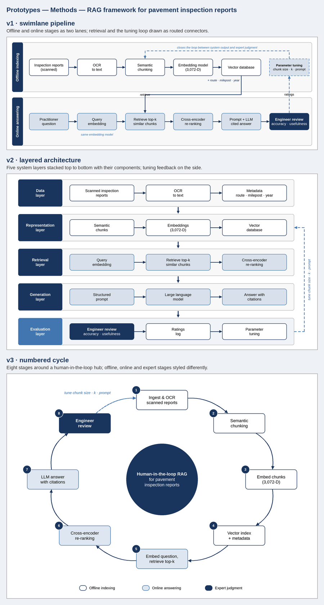
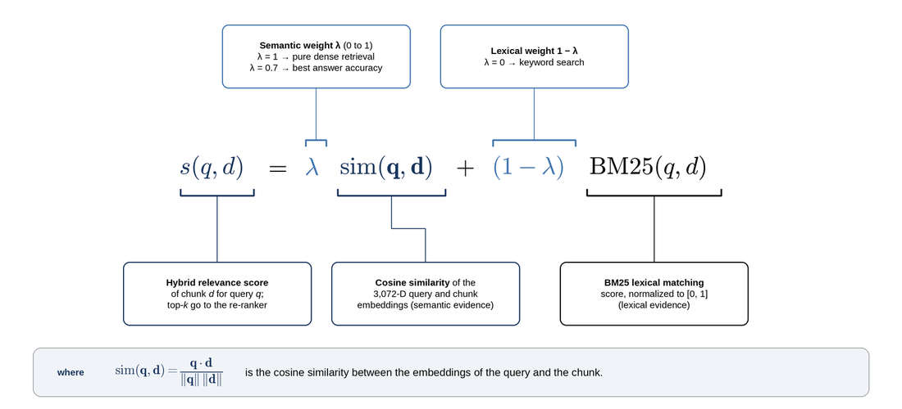

# tidyfigs

**Editable, publication-grade draw.io figures for academic papers — from an image, from your text, or from a diagram you already have.**

tidyfigs is a [Claude skill](https://docs.claude.com/en/docs/agents-and-tools/agent-skills/overview) plus a Python toolkit. It never traces pixels or rasterizes text: every figure is built as native draw.io objects from a small Python *build script*, so boxes, arrows, labels and equations stay editable in draw.io / diagrams.net, and the whole figure can be regenerated or re-themed in one command.

[](https://github.com/anatems1/tidyfigs/actions/workflows/ci.yml)


| Mode | You give it | You get |
|---|---|---|
| **A · Image → draw.io** | a PNG/JPG/WebP of a diagram, flowchart, infographic or schematic | `fig.drawio` with native shapes, attached connectors and real text, plus a 300-dpi preview |
| **B · Text → figure** | a methods section, framework description, comparison, results or LaTeX equation | three structurally different prototypes side by side; you pick one, it gets finalized |
| **C · Enhance** | any `.drawio` file | a short interview about venue and audience, then a print-size-correct, venue-ready figure exported to PDF/SVG/PNG |

<p align="center">
  
  <br><em>Mode B — one methods paragraph, three prototypes (swimlane pipeline · layered architecture · numbered cycle).</em>
</p>

<p align="center">
  
  <br><em>Mode B — a hybrid-retrieval equation turned into an annotated figure (native, editable MathJax).</em>
</p>

---

## Contents

- [Installing the skill](#installing-the-skill)
- [Using it with Claude](#using-it-with-claude)
- [Using the toolkit directly (no Claude)](#using-the-toolkit-directly-no-claude)
- [Themes and venues](#themes-and-venues)
- [Repository layout](#repository-layout)
- [Development](#development)
- [Limitations](#limitations)

---

## Installing the skill

The installable skill is the folder [`skills/tidyfigs/`](skills/tidyfigs) — four files:

| File | Purpose |
|---|---|
| `SKILL.md` | the workflow Claude follows (modes, rules, stopping criteria) |
| `REFERENCE.md` | full API, figure catalog, style guide, fix catalog, troubleshooting |
| `EXAMPLES.md` | worked examples worth copying |
| `drawio_toolkit.py` | **all** code (20 scripts, themes, templates, examples) in one self-unpacking file |

The skill needs **code execution** in whatever Claude surface you use.

**Claude apps (claude.ai, desktop, mobile)** — download `tidyfigs.zip` from the latest [release](../../releases) or the CI artifact (or build it with `python tools/package_skill.py`), then upload it under *Skills* in Claude's settings.

**A claude.ai Project** — alternatively, add the four files from `skills/tidyfigs/` to the Project's knowledge. Claude reads `SKILL.md` and runs `drawio_toolkit.py` from there.

**Claude Code** — copy the folder into your skills directory:

```bash
# for you, in every project
mkdir -p ~/.claude/skills && cp -r skills/tidyfigs ~/.claude/skills/
# or only for one repository (commit it so collaborators get it too)
mkdir -p .claude/skills && cp -r skills/tidyfigs .claude/skills/
```

**Python dependencies** (wherever the code runs):

```bash
pip install -r requirements.txt            # numpy, pillow, matplotlib, pyyaml
pip install -r requirements-optional.txt   # scipy/opencv (detection), pytesseract (OCR), python-docx, pypdf
```

Recommended extras: the `tesseract` binary for OCR in image mode, the Liberation fonts (`fonts-liberation`, metric-compatible with Helvetica/Times) for accurate text measurement, and the [draw.io desktop app](https://github.com/jgraph/drawio-desktop/releases) whose CLI gives pixel-exact renders and vector PDF/SVG export.

---

## Using it with Claude

Once installed, just ask. Claude picks the mode from your request and asks only if it is genuinely ambiguous.

**Mode A — convert an image**

> Convert `figures/architecture.png` into an editable draw.io file. Keep our lab colors: navy `#19355d` and steel blue `#4276b0`.

Claude measures the image on its real pixel grid, plans every element, writes `build.py`, then iterates *build → render → compare → lint* until the preview matches the source. You get `figures/architecture.drawio`, `figures/architecture#drawio.png`, and a report of anything that is not fully native (embedded photos, emoji placeholders for icons).

**Mode B — make a figure from text**

> Here's the methods section of my paper — make me a figure for it. *(paste text, or point to `drafts/methods.md`)*

Claude inventories the passage (entities, steps, relations, quantities), builds three prototypes that differ in *structure*, not just styling, checks every label against your wording, and shows you a comparison sheet with draft captions. Anything it had to interpret rather than read from the text is listed explicitly. Reply "v2, but with the feedback loop from v1" and it finalizes.

**Mode C — polish for publication**

> Get `fig3.drawio` ready for an IEEE double-column paper, grayscale-safe.

Claude audits the figure at its real printed size, asks a few short rounds of questions (purpose, audience, emphasis, fonts, math notation, caption), confirms a plan, applies it, and exports `fig3_ENHANCED.pdf/.svg/.png` with a before/after sheet and a change log. Your hand edits are preserved.

Tips: name the target venue and column width early; give your exact color hex codes and font; for text mode, paste the passage as it appears in the paper (labels use your wording); say which prototype you want and what to borrow from the others.

---

## Using the toolkit directly (no Claude)

Everything Claude runs is a normal CLI. Below, `T` means `python skills/tidyfigs/drawio_toolkit.py` (any tool takes `--help`):

```bash
T list                         # tools, libraries and bundled files
T unpack ./tidyfigs           # optional: write scripts/ assets/ examples/ as a normal folder
```

The bundle unpacks itself on first use into `~/.cache/drawio_toolkit/<version>` (override with `DRAWIO_TOOLKIT_HOME`).

**Mode A — image → draw.io**

```bash
T new_build images/fig.png --theme my_theme.yaml     # scaffold images/fig_drawio_work/ + inspection
#   edit images/fig_drawio_work/build.py  (detected boxes are pre-filled)
T iterate images/fig_drawio_work --note "snap panels"   # build, render, compare, lint, snapshot
T render_preview images/fig.drawio -o "images/fig#drawio.png" --dpi 300
```

**Mode B — text → prototypes**

```bash
T new_figures drafts/methods.md                # or: T new_figures --text "..." --name rag_pipeline
#   edit drafts/methods_figures/build.py  (three builder functions + VARIANTS)
T prototype drafts/methods_figures --note "first pass"   # previews, lint, faithfulness check, sheet
T finalize drafts/methods_figures --pick v2 --name rag_pipeline
```

**Mode C — enhance**

```bash
T start_enhance fig3.drawio                    # audit + interview questions in fig3_enhance_work/
T brief fig3_enhance_work --set target.venue=ieee --set target.column=double \
        --set target.print_mode=grayscale_safe --resolve
T rebuild fig3_enhance_work                    # if a build script exists, else: T enhance fig3.drawio ... --all
T report fig3_enhance_work --export pdf,svg,png
```

**As a library**

```python
import drawio_toolkit; drawio_toolkit.setup()      # puts the unpacked scripts/ on sys.path
from drawio_kit import Diagram

d = Diagram(600, 200, math=True)
d.rect(40, 70, 140, 60, "**Encoder**", fill="primary", color="background", rounded=True, id="enc")
d.rect(420, 70, 140, 60, "Decoder", stroke="primary", rounded=True, id="dec")
d.edge([], src="enc", tgt="dec", sw="thick")
d.text("latent \\(z\\)", 300, 82, size="label")        # inline LaTeX, native MathJax in draw.io
d.save("toy.drawio")
```

Colors, sizes and strokes are **theme roles** (`primary`, `body`, `thick`), not hex values — change the theme and re-run the build script to restyle the whole figure. The full API is in [`REFERENCE.md`](skills/tidyfigs/REFERENCE.md) §2–4.

**Run the bundled examples**

```bash
T unpack ./tidyfigs
python tidyfigs/examples/01_two_panel_simple.py --out out/01.drawio   # image-mode builds (01–04)
T prototype tidyfigs/examples/D_equation                               # text-mode passages (A–F)
```

### Output naming

| File | Meaning |
|---|---|
| `fig.drawio` · `fig#drawio.png` | image-mode result next to the source image |
| `<name>.drawio` · `CHOSEN.md` | finalized text-mode figure, with caption and interpreted items |
| `fig#ENHANCED.drawio` | enhanced figure (quote `#` in shells) |
| `fig_ENHANCED.pdf/.svg/.png` | exports — no `#`, so they work with `\includegraphics` |
| `*_drawio_work/`, `*_enhance_work/` | build scripts, themes, notes and iteration history; keep them to regenerate later |

---

## Themes and venues

A theme is a small YAML/TOML/JSON file of roles:

```yaml
colors:  {primary: "#19355d", secondary: "#4276b0", neutral: "#a4a4a4", text: "#000000", background: "#ffffff"}
fonts:   {sans: {family: "Helvetica"}, serif: {family: "Times New Roman"}}
sizes:   {heading: 15, body: 13, label: 11.5, small: 10.5, equation: 30}
strokes: {thin: 1, normal: 1.5, thick: 2}
opacity: {tint: 18, soft: 35}
```

Bundled presets: navy default, **Okabe–Ito** (color-blind safe) and **grayscale**. Venue presets (generic, IEEE, Elsevier, Springer LNCS, thesis, slides) set column widths and minimum printed font sizes — they are typical values, so check them against your venue's author guidelines.

---

## Repository layout

```
tidyfigs/
├── README.md
├── LICENSE
├── CHANGELOG.md
├── CONTRIBUTING.md
├── requirements.txt              core deps: numpy, pillow, matplotlib, pyyaml
├── requirements-optional.txt     scipy, opencv, pytesseract, python-docx, pypdf
├── .github/workflows/ci.yml      bundle check + smoke tests (py3.9, 3.12) + zip artifact
│
├── skills/tidyfigs/             ← THE SKILL (what users install)
│   ├── SKILL.md
│   ├── REFERENCE.md
│   ├── EXAMPLES.md
│   └── drawio_toolkit.py         generated from src/ — do not edit by hand
│
├── src/                          ← readable source of truth, bundled into drawio_toolkit.py
│   ├── scripts/                  16 CLI tools + 4 libraries
│   │   ├── drawio_kit.py           builder API (Diagram, Theme)
│   │   ├── figlib.py               text-mode components (lanes, chains, cycles, tables, equations…)
│   │   ├── drawio_doc.py           load/edit existing .drawio files
│   │   ├── faithful.py             label-vs-passage faithfulness check
│   │   ├── new_build.py  inspect_image.py  iterate.py  compare.py           (image mode)
│   │   ├── analyze_text.py  new_figures.py  prototype.py  finalize.py       (text mode)
│   │   ├── start_enhance.py  brief.py  rebuild.py  enhance.py               (enhance mode)
│   │   ├── audit_drawio.py  report.py
│   │   └── render_preview.py  lint_drawio.py                                (shared)
│   ├── assets/
│   │   ├── theme.yaml  theme_image.yaml  venues.yaml
│   │   ├── brief_template.yaml  questions.yaml
│   │   ├── build_template_image.py  build_template_text.py
│   │   └── themes/               navy_default.yaml  okabe_ito.yaml  grayscale.yaml
│   └── examples/
│       ├── _common.py
│       ├── 01_two_panel_simple.py … 04_complex_manifold.py     image mode, tiers 1–4
│       └── A_methods_pipeline/ … F_metric_manifold_geometry/   text mode (passage.md + build.py)
│
├── tools/
│   ├── build_bundle.py           src/ → skills/tidyfigs/drawio_toolkit.py  (--check for CI)
│   ├── bundle_stub.py            header/footer of the bundle (dispatcher, unpack, setup)
│   └── package_skill.py          → dist/tidyfigs.zip
│
├── tests/
│   └── test_smoke.py             bundle in sync; unpack; one build per mode
│
└── docs/images/                  README figures
```

**Why two copies of the code?** A skill is easiest to install as a handful of files, so all the code ships as one self-unpacking `drawio_toolkit.py`. That file is unreadable in a diff, so `src/` holds the real sources and `tools/build_bundle.py` regenerates the bundle; CI fails if they drift apart.

---

## Development

```bash
git clone https://github.com/anatems1/tidyfigs && cd tidyfigs
pip install -r requirements.txt pytest
# edit files in src/ (and the docs in skills/tidyfigs/)
python tools/build_bundle.py            # regenerate the bundle
python tools/build_bundle.py --check && pytest -q
python tools/package_skill.py           # dist/tidyfigs.zip for a release
```

See [CONTRIBUTING.md](CONTRIBUTING.md). Keep `SKILL.md` and `REFERENCE.md` in step with the code — they are the instructions Claude follows.

---

## Limitations

- The built-in preview renderer approximates draw.io: emoji icons appear as grey squares, cylinders and documents as rectangles, math via matplotlib mathtext. Install the draw.io CLI for exact renders (`T render_preview FILE --engine drawio`).
- Vector PDF/SVG export needs the draw.io CLI; without it, export from draw.io (*File → Export as → PDF/SVG*, "Crop" checked).
- Image mode rebuilds diagrams, not photographs: photos, textures and logos are embedded as crops (with their labels rebuilt natively on top), and very dense marks are merged into one SVG layer.
- The text-mode faithfulness check is lexical. It catches words that are not in your passage, not a wrong arrow between correct words — always read the arrows.
- Venue presets are typical values, not authoritative.

## About the name

*Tidy figures*: equal sizes for peers, one gap per row, aligned edges, attached connectors, theme roles instead of stray colors, and every element still editable in draw.io.

## License

[MIT](LICENSE)
